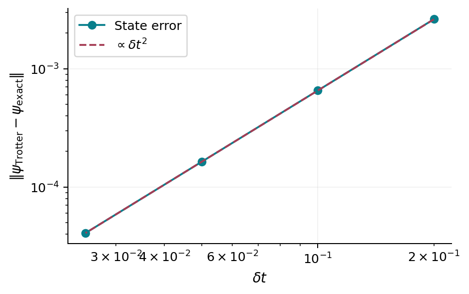

# Exact computation and the logic of numerical evidence {#sec-computation}

## What a finite calculation can establish

Exact diagonalization solves the chosen finite matrix to numerical precision.
It does not remove model approximations, preparation errors, finite-size
effects, or uncertainty in extrapolating to infinite time. This distinction is
especially consequential for localization transitions, anomalous transport,
spectral chaos, and monitored criticality.

This chapter gives a working computational toolkit rather than a software
catalog. We construct a Hamiltonian from bit operations, propagate states by
diagonalization and Krylov projection, measure entanglement, and design checks
that can falsify the calculation. Julia is used throughout; the supplied programs
need only standard libraries.

## Constructing a spin-chain matrix

Use integers $s=0,\ldots,2^L-1$ to label bit strings. Bit $j-1$ is site $j$;
zero denotes $S_j^z=+1/2$, one denotes $-1/2$. An XXZ bond has diagonal
contribution $J\Delta S_j^zS_{j+1}^z$ and exchanges antiparallel spins with
matrix element $J/2$. Flipping both bits uses exclusive-or, denoted `⊻` in
Julia. A minimal implementation is

```julia
using LinearAlgebra
function xxz_dense(L; J=1.0, Δ=1.0)
    H = zeros(2^L, 2^L)
    for s in 0:2^L-1, j in 1:L-1
        a = (s >> (j-1)) & 1
        b = (s >> j) & 1
        H[s+1,s+1] += J*Δ*(0.5-a)*(0.5-b)
        if a != b
            f = s ⊻ (1 << (j-1)) ⊻ (1 << j)
            H[f+1,s+1] += J/2
        end
    end
    Hermitian(H)
end
```

The basis convention is explicit. The two-spin matrix should have an
antiparallel block with off-diagonal entries $J/2$. At $\Delta=1$ its
eigenvalues are a triplet at $J/4$ and a singlet at $-3J/4$. This simple test
catches sign and normalization errors more effectively than a large opaque
benchmark.

For a fixed magnetization sector, enumerate only integers with a specified
population count and map each allowed integer to its sector index. Store the
Hamiltonian sparsely or implement its action directly. Never form the complete
$2^L\times2^L$ dense matrix merely to discard most rows afterward at a size
where that matrix is already prohibitive.

## Costs and representation choices

A complex state vector costs $16\,2^L$ bytes in double precision. A dense
complex matrix costs $16\,4^L$ bytes. Full dense diagonalization scales
cubically in matrix dimension and must store eigenvectors if they are needed.
Sparse matrix-vector application for a local spin chain costs roughly
$O(L2^L)$ before symmetry reductions. Sparse iterative eigensolvers find a few
extremal eigenstates efficiently but do not automatically produce the middle
of an exponentially dense spectrum.

These estimates make the scientific choice clear. To study a quench you may
need only the exponential acting on one vector. To study all nearest-neighbor
level spacings you need a large set of eigenvalues within a resolved sector.
To study long one-dimensional dynamics you may need tensor networks, whose
limitation is entanglement rather than only Hilbert-space dimension.

## Propagation by spectral decomposition

For $H=V\operatorname{diag}(E_n)V^\dagger$, compute
$a=V^\dagger\psi_0$ once and then

$$
\psi(t)=V\big(e^{-iE_n t}a_n\big)_n.
$$ {#eq-compute-spectral}

Every requested time is independent. There is no timestep accumulation error,
although floating-point eigensystem and phase errors remain. Norm and energy
must be constant. For a time-dependent Hamiltonian the formula applies only
within a piece with fixed $H$; changing parameters requires correctly ordered
propagators.

A diagonal ensemble prediction for $O$ is
$O_D=\sum_n|a_n|^2(V^\dagger OV)_{nn}$ in the nondegenerate case. Comparing
the time trace with $O_D$ checks dephasing. Comparing with a Gibbs state at the
same energy tests an additional thermalization claim; the two comparisons
should not be conflated.

## Deriving Krylov propagation

Expand $e^{-iHt}\psi_0$ in powers of $H$. Its low orders lie in
$\mathcal K_m=\operatorname{span}\{\psi_0,H\psi_0,\ldots,H^{m-1}\psi_0\}$.
Let $Q_m$ have orthonormal columns spanning this space and let
$K_m=Q_m^\dagger H Q_m$. Projecting the Schrödinger equation gives

$$
\psi_m(t)=\|\psi_0\|Q_m e^{-iK_m t}e_1.
$$ {#eq-compute-krylov}

For Hermitian $H$, the Lanczos recurrence produces a tridiagonal $K_m$ in
exact arithmetic. With $q_0=0$, it forms
$v=Hq_j-\beta_{j-1}q_{j-1}$, $\alpha_j=q_j^\dagger v$,
$v\leftarrow v-\alpha_jq_j$, then $\beta_j=\|v\|$ and
$q_{j+1}=v/\beta_j$. Finite precision can lose orthogonality, so a transparent
reference implementation reorthogonalizes. The supplied code does this twice
and projects with the full small Hermitian matrix.

The projected state is normalized because both $Q_m$ and the small exponential
are isometries. Thus norm conservation alone cannot certify Krylov accuracy.
Increase $m$, shorten a propagation interval, compare an observable or state
with a denser reference, and inspect the residual associated with the next
basis vector. For fixed $m$, long-time use eventually fails even though the
norm remains perfect.

## Entanglement and a convention check

For a contiguous partition of the lowest $\ell$ bits, reshape
$\psi$ into a $2^\ell\times2^{L-\ell}$ matrix, find singular values $s_a$,
and evaluate $-\sum_a s_a^2\ln s_a^2$. In Julia,

```julia
function entropy_cut(ψ, ell, L)
    p = abs2.(svdvals(reshape(ψ, 2^ell, 2^(L-ell))))
    -sum(x*log(x) for x in p if x > 1e-14)
end
```

The cutoff avoids evaluating $\ln0$; it is not an entanglement truncation in
the evolution. Verify it on a product state and a Bell pair straddling the cut.
A noncontiguous subsystem requires permuting tensor indices first. For a mixed
state, reshaping a density matrix as if it were a pure vector computes a
different object, sometimes called operator-space entanglement, not the
subsystem's physical entropy.

{#fig-compute-quench}

## Trotter error and convergence, derived

Split a nearest-neighbor Hamiltonian into sums of disjoint even and odd bonds,
$H=H_e+H_o$. Terms within each sum commute. A symmetric step is

$$
U_2(\delta t)=e^{-iH_e\delta t/2}e^{-iH_o\delta t}
e^{-iH_e\delta t/2}.
$$ {#eq-compute-trotter}

The Baker–Campbell–Hausdorff expansion shows a local error of order
$\delta t^3$, involving nested commutators such as
$[H_e,[H_e,H_o]]$. Repeating $t/\delta t$ steps at fixed $t$ gives global
error $O(t\delta t^2)$ when the relevant norms remain controlled. Halving
$\delta t$ should reduce a leading state error by about four. It need not
reduce a particular observable error by exactly four if its leading coefficient
vanishes or other errors dominate.

The supplied dense-state Trotter reference is deliberately small. It applies
two-site gates to a full vector and isolates splitting error. A scalable TEBD
calculation also truncates Schmidt spectra; [chapter 31](31-tensor-networks.qmd)
separates that error from the timestep error.

{#fig-compute-trotter}

## Sampling, disorder, and finite-size claims

For independent samples $x_a$, the standard error of their mean is
$s/\sqrt N$, where $s$ is the sample standard deviation. Time points along
one trajectory are correlated and do not supply $N$ independent samples.
Disorder averaging has another hierarchy: eigenstates from the same realization
share its rare-region structure. Bootstrap entire realizations when that is the
sampling unit; resampling all eigenstates independently can underestimate
uncertainty.

Broad distributions demand more than means. Compare typical values such as
$\exp\langle\ln x\rangle$, medians, quantiles, and arithmetic means as
appropriate. A rare sample can dominate transport or avalanche diagnostics.
For a finite-size crossing, vary the fitted window, include plausible corrections
to scaling, and test whether an alternative crossover model fits equally well.
A visually persuasive collapse with several adjustable parameters is not by
itself a universality-class determination.

## A reproducibility contract

The checked-in calculations specify Hamiltonian, units, boundaries, state,
partition, random seed, algorithm, numerical parameters, and provenance. They
check an exact two-spin identity, a one-particle hopping block, charge
conservation, norm and energy, Gaussian projector conservation, Krylov accuracy,
and Trotter order. The commands in the [laboratory](computational-laboratory.qmd)
recreate their data. These checks are necessary evidence about implementation;
they do not constitute an independent peer review of every theoretical claim.

For a research reproduction, first reproduce one precisely defined quantity at
a size where a second method is possible. Then scale up one resource at a time.
Explain any mismatch before adding more physics. Tensor-network and exact
calculations are complementary checks, particularly when their failure modes
are different [@vidal2004tebd; @schollwock2011mps; @haegeman2016tdvp].

## Exercises and solutions

1. Compute the two-spin XXZ spectrum analytically and compare it with the bit
   implementation. What changes if $S$ is replaced by $\sigma$ in the exchange?
2. For a quench, compare norm conservation in a deliberately underconverged
   Krylov calculation with its actual state error. Explain the outcome.
3. Plot Trotter error versus timestep and fit the last three points. Increase
   final time and check the range over which second-order behavior persists.
4. Generate a disorder observable whose distribution is broad. Compare
   bootstrapping realizations with bootstrapping all eigenstates independently.
5. Add a known exact symmetry to your Hamiltonian and intentionally combine
   its sectors in a spacing analysis. Quantify how the gap ratio changes.

**Solution to 1.** The parallel states have energy $J\Delta/4$. The
antiparallel block is $-J\Delta I/4+(J/2)X$, with eigenvalues
$-J\Delta/4\pm J/2$. At $\Delta=1$ this gives three $J/4$ levels and
one $-3J/4$ level. Replacing both spins in every bond by Pauli matrices
multiplies the exchange by four.

**Solution to 2.** $\|Q_m e^{-iK_mt}e_1\|=1$ follows identically from
orthonormal columns and Hermitian $K_m$. It holds even if $\mathcal K_m$
is too small to approximate the true trajectory. A conserved norm is an
implementation check and a weak accuracy diagnostic; convergence in $m$
or a residual is needed for the latter.
