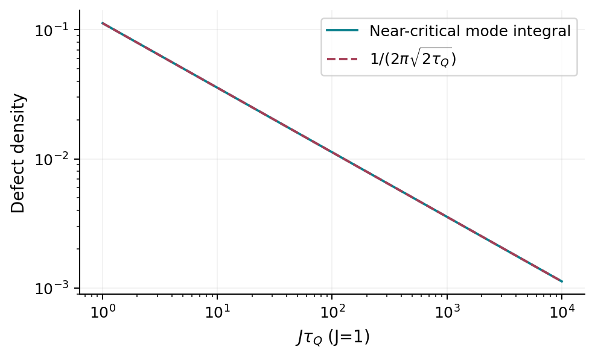
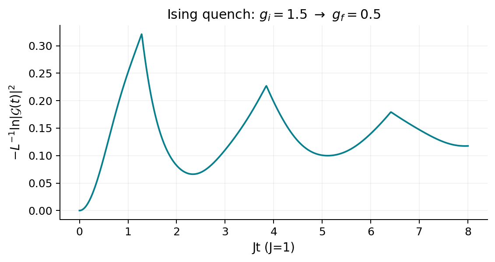

# Critical dynamics, quenches, and quantum control {#sec-critical-dynamics}

## Two different meanings of a dynamical transition

The word transition can describe a nonanalytic long-time state, a universal
failure of adiabaticity near an equilibrium critical point, or a singularity of
an extensive return amplitude at a finite time. These are different questions.
This chapter develops the last two in a model where they can be calculated,
then asks how control can suppress unwanted excitations.

The prerequisite is the Schrödinger equation for a two-level system. Critical
exponents and Bogoliubov modes are introduced here. Throughout, the Ising
Hamiltonian uses Pauli matrices,
$H=-J\sum_jX_jX_{j+1}-Jg\sum_jZ_j$, with $J>0$.

## Why slow passage fails near criticality

Let $\lambda$ measure distance from a continuous quantum critical point. The
equilibrium correlation length diverges as
$\xi\sim|\lambda|^{-\nu}$, where $\nu$ is the correlation-length exponent.
A characteristic low-energy gap scales as
$\Delta\sim\xi^{-z}\sim|\lambda|^{z\nu}$, defining the dynamical exponent
$z$. The associated response time is of order $1/\Delta$. These scaling
relations apply in the critical region and presume that no additional low-energy
scale dominates the protocol.

For a linear ramp $\lambda=t/\tau_Q$, the fractional parameter-change time is
$|\lambda/\dot\lambda|=|t|$. An estimate of the breakdown of adiabatic
following equates it to the response time:

$$
|\widehat t|\sim|\widehat t/\tau_Q|^{-z\nu},\qquad
\widehat t\sim\tau_Q^{z\nu/(1+z\nu)},\quad
\widehat\xi\sim\tau_Q^{\nu/(1+z\nu)}.
$$ {#eq-critical-kzscale}

If independently excited domains are separated by $\widehat\xi$, a defect
density scales as $n_{\mathrm{ex}}\sim\widehat\xi^{-d}$ in $d$ dimensions.
This Kibble–Zurek estimate predicts an exponent, not a universal prefactor.
The language of a frozen interval is an approximation: the state keeps evolving
unitarily. Exact solvable dynamics can test and sharpen the scaling argument.

At finite $L$, the critical gap never closes in the same way; sufficiently
slow ramps become adiabatic. The scaling window requires microscopic lengths
$\ll\widehat\xi\ll L$. At finite temperature, an initial thermal length and
occupation factors add further scales. Dissipation can change $z$ and the
meaning of relaxation time. A collapse without checking these inequalities is
inconclusive.

## Landau–Zener passage and the Ising chain

A two-level Hamiltonian
$H(t)=a t\,\tau_z+b\tau_x$ has diabatic levels crossing linearly and a
minimum avoided-crossing gap $2|b|$. Starting in its ground state at
$t\to-\infty$ and evolving to $t\to+\infty$ produces the excited-state
probability $p=e^{-\pi b^2/|a|}$. The result follows by reducing the coupled
first-order Schrödinger equations to the parabolic-cylinder equation and matching
their asymptotic solutions. The infinite endpoints, constant slope, and
two-level isolation are assumptions; finite-endpoint ramps have corrections.

Jordan–Wigner and Bogoliubov transformations turn an Ising chain into independent
$(k,-k)$ pair problems. A suitable even-parity basis gives

$$
\mathsf h_k(t)=2J[(g(t)-\cos k)\tau_z+\sin k\,\tau_x].
$$ {#eq-critical-mode}

Take $g(t)$ decreasing through one with $|\dot g|=1/\tau_Q$. A mode crosses
at $g=\cos k$. Near that crossing $|a|=2J/\tau_Q$ and
$b=2J\sin k$, so the ideal passage gives
$p_k=e^{-2\pi J\tau_Q\sin^2 k}$. For a ramp that begins in the paramagnet
and ends in the ferromagnet before crossing the other critical point at $g=-1$,
the slow-ramp excitations come from $k\simeq0$. Thus
$p_k\simeq e^{-2\pi J\tau_Q k^2}$ for the excited low-momentum modes.
Do not integrate the all-crossings formula near $k=\pi$ for a protocol that
never reaches those modes' avoided crossings.

At a final $g=0$, the defect or kink density is related to the quasiparticle
density. In the slow-ramp thermodynamic window,

$$
n_{\mathrm{kink}}\simeq\frac1\pi\int_0^\infty dk\,
e^{-2\pi J\tau_Q k^2}
=\frac{1}{2\pi\sqrt{2J\tau_Q}}.
$$ {#eq-critical-defects}

The exponent $1/2$ agrees with $d=z=\nu=1$. The Gaussian integral fixes a
prefactor for this particular normalization and ideal protocol. Dziarmaga's
exact solution made the quantum mode mechanism explicit
[@dziarmaga2005ising]. A first reproduction should integrate the two-level
equations with stated finite endpoints, compare each $p_k$ with its passage
limit, and only then sum over momenta.

{#fig-critical-kz}

## A finite-time singularity in a return amplitude

For a sudden quench, define
$\mathcal G(t)=\langle\psi_0|e^{-iH_ft}|\psi_0\rangle$ and
$\lambda(t)=-\lim_{L\to\infty}L^{-1}\ln|\mathcal G(t)|^2$.
The overlap is generally exponentially small in $L$, so its intensive logarithm
is the meaningful thermodynamic quantity. A finite-dimensional amplitude is
analytic in time, but it can have isolated real zeros, at which its logarithm
diverges. Away from such zeros the finite-size rate is smooth. Robust
thermodynamic cusps arise from an accumulation of zeros in the large-system
limit; an isolated two-level zero is not by itself a thermodynamic transition.

For an Ising ground-state quench from $g_i$ to $g_f$, let
$\epsilon_k^f=2J\sqrt{1+g_f^2-2g_f\cos k}$ and let $n_k$ be the
probability of exciting the final pair. The mode overlap has squared modulus

$$
|\mathcal G_k(t)|^2
=1-4n_k(1-n_k)\sin^2(\epsilon_k^f t),\qquad
\lambda(t)=-\int_0^\pi\frac{dk}{2\pi}\ln|\mathcal G_k(t)|^2.
$$ {#eq-critical-rate}

A real-time zero requires $n_{k_*}=1/2$ and
$\epsilon_{k_*}^f t_*=(m+1/2)\pi$. The first condition means equal overlap
with the two final mode eigenstates, rather than ordinary thermal occupation.
The dot product of initial and final mode fields vanishes at

$$
\cos k_* = \frac{1+g_i g_f}{g_i+g_f},\qquad
t_m=\frac{(m+1/2)\pi}{\epsilon_{k_*}^f},
$$ {#eq-critical-cusptimes}

provided the right-hand side lies in $[-1,1]$ and the quench is nontrivial.
For positive fields on opposite sides of one, such a momentum exists. Near a
simple zero, the integrand behaves like the logarithm of a positive quadratic
form in $k-k_*$ and $t-t_*$. Integrating over $k$ produces a term proportional
to $|t-t_*|$, hence a cusp in the return rate.

This is the basic dynamical quantum phase transition of
Heyl, Polkovnikov and Kehrein [@heyl2013dqpt]. Their exact Ising construction
motivates searching for robustness in interacting systems; the relation between
return-rate singularities and local order is model and protocol dependent.
The review [@heyl2018review] maps extensions and unsettled interpretations.

{#fig-critical-return}

## What Fisher zeros do and do not prove

Continue $t$ to a complex variable. Zeros of a finite-size partition-like
amplitude can accumulate on curves as $L$ increases. When an accumulation curve
crosses real time, the limiting logarithm can become nonanalytic. This resembles
the equilibrium relation between complex zeros and free-energy singularities,
but the return amplitude depends strongly on the initial state. It is not a
thermodynamic partition function with a positive probability measure at real
time.

An observed cusp therefore does not establish thermalization, a transport
transition, or stable time-crystalline order. Conversely a dynamical phase can
be meaningful without a Loschmidt cusp. Asking which quantity is singular and
which limit produces it is more useful than applying a shared name.

## Adiabatic gauge potentials and controlled shortcuts

Suppose $H(\lambda)|n(\lambda)\rangle=E_n|n(\lambda)\rangle$ is
nondegenerate. Differentiating and projecting onto $m\ne n$ gives
$\langle m|\partial_\lambda n\rangle
=\langle m|\partial_\lambda H|n\rangle/(E_n-E_m)$.
The Hermitian adiabatic gauge potential has off-diagonal elements

$$
(\mathcal A_\lambda)_{mn}
=i\frac{\langle m|\partial_\lambda H|n\rangle}{E_n-E_m},
\quad m\ne n.
$$ {#eq-critical-agp}

Adding $\dot\lambda\mathcal A_\lambda$ to the Hamiltonian cancels
transitions between its instantaneous eigenspaces. Its diagonal part is a
phase-gauge choice. At a closing gap the exact operator can become large and
nonlocal; formal existence at finite size does not make it an available control.

A practical approach chooses a local operator ansatz
$\mathcal A^*=\sum_a\alpha_a O_a$ and minimizes a quadratic norm of
$G=\partial_\lambda H+i[\mathcal A^*,H]$. The exact off-diagonal matrix
elements make $G$ diagonal. A Hilbert–Schmidt objective
$\operatorname{Tr}G^2$ turns the variational problem into linear equations
for $\alpha_a$, although a state-weighted norm may better match a target
experiment. This is the principle of local counterdiabatic control
[@sels2017counterdiabatic]. Reduced excitation is an outcome to test under
amplitude, locality, and noise constraints; no method circumvents a physical
resource bound for free.

The connection to Floquet engineering is direct: fast modulation can synthesize
otherwise unavailable terms, while also introducing micromotion and heating.
Optimization must therefore compare complete protocols at the same available
resources, not ideal target operators with unconstrained implementations.

## Exercises and worked solutions

1. For a nonlinear ramp $\lambda=\operatorname{sgn}(t)|t/\tau_Q|^r$,
   derive the Kibble–Zurek correlation length and defect exponent.
2. Numerically solve one Ising mode over a finite ramp. Separate finite-endpoint
   errors from timestep errors, then identify the momentum interval where the
   Landau–Zener approximation is accurate.
3. For $g_i=1.5$, $g_f=0.5$, find $k_*$ and the first return-rate cusp time.
   Compare with the plotted result.
4. Derive the exact gauge potential for $H=\lambda Z+\Delta X$ and discuss
   the limit $\Delta\to0$.
5. Design an experiment that distinguishes a local order-parameter singularity
   from a return-rate singularity. State what data are needed for each.

**Solution to 1.** The change time is $|t|/r$. Equating it with
$|t/\tau_Q|^{-rz\nu}$ gives
$\widehat t\sim\tau_Q^{rz\nu/(1+rz\nu)}$ and
$\widehat\xi\sim\tau_Q^{r\nu/(1+rz\nu)}$. Thus
$n\sim\tau_Q^{-rd\nu/(1+rz\nu)}$ under the same defect-counting assumptions.
Changing the ramp also changes which portion of the protocol dominates errors.

**Solution to 3.** $\cos k_*=0.875$, so $k_*\simeq0.50536$. The final
mode energy is $2J\sqrt{0.375}\simeq1.22474J$ and
$Jt_0=\pi/(2\sqrt{1.5})\simeq1.28255$. The spacing of subsequent cusps is
$\pi/\epsilon_{k_*}^f$.

**Solution to 4.** A rotation about $Y$ aligns the field vector
$(\Delta,0,\lambda)$. Its polar angle obeys
$\partial_\lambda\theta=-\Delta/(\lambda^2+\Delta^2)$, yielding
$\mathcal A_\lambda=-\Delta Y/[2(\lambda^2+\Delta^2)]$ in the stated
convention. Its peak norm diverges as $1/|\Delta|$; an avoided crossing that
becomes exact demands an unbounded ideal control at fixed ramp rate.
