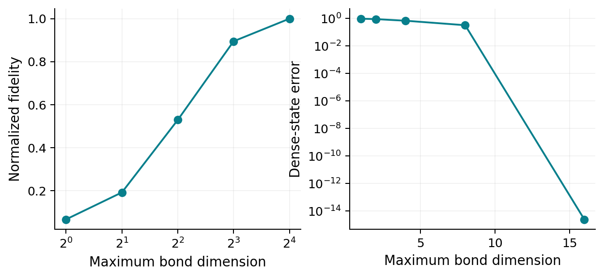

# Tensor networks and controlled time evolution {#sec-tensor-networks}

## Compression is a physical hypothesis

A state of $L$ spins has exponentially many coefficients. Many states of
physical interest occupy a much smaller structured family because their
Schmidt spectra decay rapidly across spatial cuts. Tensor networks encode that
structure. Their success is not a general repeal of exponential complexity:
generic long-time pure states require exponentially large resources.

This chapter derives matrix product states, their gauges, truncation errors,
and the principal time-evolution methods. Only singular value decomposition and
unitary evolution are assumed. The goal is to understand what an algorithm
approximates, which errors can be checked, and when its apparent convergence
may be misleading.

## Repeated Schmidt decomposition gives an MPS

Write $\psi_{s_1\ldots s_L}$, where each $s_j$ takes $d$ values. Reshape
the coefficient array into a $d\times d^{L-1}$ matrix and perform an SVD:
$\psi=U_1 S_1 V_1^\dagger$. Regard $U_1$ as the first tensor
$A_1^{s_1}$ and reshape $S_1V_1^\dagger$ into a matrix with row index
$(\alpha_1,s_2)$. Repeat. The result is

$$
\psi_{s_1\cdots s_L}
=\sum_{\alpha_1\cdots\alpha_{L-1}}
(A_1^{s_1})_{1\alpha_1}
(A_2^{s_2})_{\alpha_1\alpha_2}\cdots
(A_L^{s_L})_{\alpha_{L-1}1}.
$$ {#eq-tensor-mps}

The internal index dimension $\chi_j$ is a bond dimension. Without truncation,
$\chi_j$ can reach $d^{\min(j,L-j)}$, so this is an exact rewriting of any
state. With a maximum $\chi$, storage becomes $O(Ld\chi^2)$. The physically
nontrivial step is approximating the state while keeping $\chi$ modest.

The tensors are a sequence of matrices labeled by physical states; contracting
their internal indices sums over virtual labels, not physical particles. A
virtual index is a bookkeeping space carrying correlations across a cut. It
does not add an independently measurable degree of freedom.

## Gauges and canonical forms

Insert any invertible matrix $G$ on a bond and its inverse on the next tensor:
$A_j^s\to A_j^sG$, $A_{j+1}^s\to G^{-1}A_{j+1}^s$. The state is unchanged.
This gauge freedom can produce numerically ill-conditioned tensors unless a
canonical form is maintained.

A left-canonical tensor satisfies
$\sum_s(A_j^s)^\dagger A_j^s=I$. A right-canonical tensor satisfies
$\sum_s A_j^s(A_j^s)^\dagger=I$. In mixed canonical form the tensors left
of a chosen bond describe orthonormal left-block states and those right of it
describe orthonormal right-block states. A diagonal matrix at the bond then
contains the actual Schmidt values. An arbitrary local tensor SVD has the
physical Schmidt interpretation only when its environments are orthonormal.

Moving the orthogonality center uses QR or SVD factorizations and absorbs the
remaining factor into a neighbor. These gauge operations are exact when no
singular values are dropped. They are essential both for stable contractions
and for assigning a meaningful truncation error.

## A precise truncation statement

Across one cut, let
$|\psi\rangle=\sum_a s_a|a_L\rangle|a_R\rangle$, with singular values
in descending order and $\sum_as_a^2=1$. The best unnormalized rank-$\chi$
approximation in the state-vector 2-norm keeps the largest $\chi$ terms. Its
squared error is the discarded weight

$$
w_\chi=\sum_{a>\chi}s_a^2.
$$ {#eq-tensor-discarded}

This is the Eckart–Young theorem applied to the coefficient matrix. After
normalization, the truncated state has squared overlap $1-w_\chi$ with the
original. For pure states the trace distance is exactly $\sqrt{w_\chi}$,
so for any bounded observable

$$
|\langle O\rangle_\psi-\langle O\rangle_{\psi_\chi}|
\leq2\|O\|\sqrt{w_\chi}.
$$ {#eq-tensor-observablebound}

The bound can be loose but has a clear meaning. Repeating truncations accumulates
errors, and recorded local discarded weights are not automatically the final
global infidelity. A telescoping norm bound accumulates terms of order
$\sqrt{w}$ rather than simply declaring the sum of weights to be an exact
error bar. More favorable estimates require additional structure or empirical
convergence.

Entropy alone also does not fully determine the required bond dimension. For an exact
rank-$\chi$ state it gives $S\leq\ln\chi$, so reproducing that entropy
requires a large bond dimension. This is not a universal fixed-error bound for
an approximation to a different target: a small broad Schmidt tail can carry
large entropy. A given entropy, however, permits very different tails
of the Schmidt spectrum. Accuracy depends on those tails and the observable.

## Working through a two-site TEBD update

For a nearest-neighbor Hamiltonian, split $H=H_e+H_o$ into commuting bond
sets. A symmetric Trotter step is
$e^{-iH_e\delta t/2}e^{-iH_o\delta t}e^{-iH_e\delta t/2}$, with global
splitting error $O(t\delta t^2)$ at fixed final time in a finite controlled
problem. Each factor is a collection of two-site gates.

Place the MPS in mixed canonical form around a target bond. Contract its
central tensors and any center Schmidt matrix into
$\Theta_{\alpha s t\beta}$. Apply
$U_{st,s't'}=\langle st|e^{-ih_{j,j+1}\delta t}|s't'\rangle$:

$$
\widetilde\Theta_{\alpha s t\beta}
=\sum_{s't'} U_{st,s't'}\Theta_{\alpha s't'\beta}.
$$ {#eq-tensor-gate}

Reshape rows as $(\alpha,s)$ and columns as $(t,\beta)$, compute
$\widetilde\Theta=U_\Theta S V_\Theta^\dagger$, retain the desired singular
values, and split the factors back into neighboring tensors. The new singular
values are Schmidt values because the outside environments were orthonormal.
Move the center consistently before the next update. A typical two-site update
costs $O(d^3\chi^3)$ up to implementation-dependent factors.

Time-evolving block decimation, or TEBD, exploits this local gate structure
[@vidal2004tebd]. Its appeal is the transparent distinction between Trotter and
truncation errors. It is less convenient for arbitrary long-range couplings,
where swap gates or other decompositions increase cost. The dense-state
reference in `numerics/ManyBodyLab.jl` performs the same splitting without
compression, so small systems isolate the Trotter error first.

## Time-dependent variational principle

An alternative begins with a variational manifold of MPS of fixed bond dimension.
The exact vector $-iH|\psi\rangle$ generally points outside its tangent space.
Project it onto that space:

$$
\partial_t|\psi\rangle=-iP_{T_\psi\mathcal M}H|\psi\rangle.
$$ {#eq-tensor-tdvp}

This follows from minimizing
$\|i\partial_t|\psi\rangle-H|\psi\rangle\|$ over tangent velocities,
the Dirac–Frenkel variational condition. One-site TDVP stays on a fixed-rank
manifold and can conserve norm and energy under its ideal projected flow.
Those conservation laws do not prove proximity to the true state: the projected
trajectory can faithfully conserve the wrong dynamics. Two-site variants permit
bond growth, then introduce a truncation.

Projector-splitting integrators organize this flow into tractable local steps
and handle Hamiltonians represented as matrix product operators
[@haegeman2016tdvp]. Important errors are the tangent-space projection error,
integrator error, and any truncation error. Increase bond dimension and compare
with TEBD or exact dynamics at overlapping sizes. Energy drift alone cannot
bound the projection error.

## Matrix product operators and mixed states

An operator has two physical indices per site. A matrix product operator, or
MPO, writes
$O_{\mathbf s,\mathbf t}=W_1^{s_1t_1}\cdots W_L^{s_Lt_L}$. Local
Hamiltonians have compact MPOs even though their full matrices are exponential.
Time-evolved operators can develop growing operator-space entanglement, so a
compact Hamiltonian does not guarantee a compact evolved observable.

A density matrix can be evolved as an MPO under a Liouvillian. Unconstrained
compression can spoil positivity; a small Frobenius error is not by itself a
guarantee of physical probabilities. Purification writes
$\rho=\operatorname{Tr}_{\mathrm{anc}}|\Psi\rangle\langle\Psi|$ on physical
and auxiliary sites, ensuring positivity if contractions and normalization are
handled consistently. Finite-temperature states follow from imaginary-time
evolution of a maximally entangled physical-ancilla state. Their costs depend on
the chosen purification and the entanglement it develops.

Quantum trajectories provide a different route: evolve many pure MPS under
specified environmental measurement records and average observables. Individual
trajectory entanglement can be much smaller than that of a chosen mixed-state
representation, but this is unraveling dependent. Sampling error remains in
addition to tensor and time-discretization errors.

## Why late times become hard

For an ergodic global quench in one dimension, a generic regime has
$S(t)\simeq s_{\mathrm{eq}}v_E t$ across a cut before saturation. An exact MPS reproducing that entropy requires
$\chi\geq e^S$. In generic quenches the broadening Schmidt spectrum also makes
fixed-error full-state approximation expensive; entropy alone does not prove
a universal fixed-error bound. In a localized effective model, $S\sim a\ln t$
instead gives a polynomial lower bound, though rare events and prefactors can
still be severe. At critical ground states logarithmic entropy produces a
different, less prohibitive scaling.

Local observables sometimes converge longer than the full-state fidelity, and
Heisenberg-picture or transverse spacetime contractions can exploit that. It is
then essential to validate the particular observable. A classical method that
reproduces one noisy local expectation has not necessarily reproduced the
entire state, while exponential state entanglement does not prove every local
observable is classically intractable. The computational task must be stated.

The runnable `numerics/mps_compression.jl` constructs MPS tensors by successive
SVDs from a small dense state, recontracts them, verifies canonical gauges,
and compares truncations with the known exact vector. It is an educational
compression reference, not a scalable MPS time-evolution implementation.

{#fig-tensor-compression}

## A convergence protocol and research bridge

Schollwöck's review [@schollwock2011mps] develops the MPS language and practical
canonical algorithms. A useful first reproduction is an XXZ product-state
quench: compare exact and compressed states for small $L$, then monitor
entanglement and the Schmidt tail as $L$ increases. A second project compares
TEBD and TDVP for the same weakly nonintegrable chain and asks when local
transport observables cease to converge.

Vary timestep at fixed large bond dimension, then vary bond dimension at a
converged timestep. Increase system size until the measured region cannot yet
have encountered boundaries. Record normalization, conserved charges, energy,
discarded spectra, and observable differences. For disorder, repeat this
analysis on difficult realizations as well as an average one. A clean mean
curve can hide uncontrolled rare samples.

## Exercises and worked solutions

1. Construct exact MPS tensors by successive SVDs for a six-qubit state. Recontract
   them and compare every coefficient. Repeat with a fixed maximum rank.
2. Derive the normalized-truncation trace distance and observable bound above.
   Compare the bound with an actual local observable error.
3. A quench has $S(t)=0.6t$ in natural units. Estimate the bond dimension needed to reproduce that entropy
   at $t=10$ and $t=20$. Explain why this is not a universal bound on an
   arbitrary fixed-error approximation to the target state.
4. Compare one-site TDVP with exact evolution for a small system at deliberately
   insufficient rank. Show that conserved energy can coexist with a growing
   state error.
5. Design a Lindblad simulation using both an MPO and MPS trajectories. Specify
   how positivity, unraveling choice, truncation, and sampling are checked.

**Solution to 2.** The normalized retained state has overlap
$\sum_{a\leq\chi}s_a^2/\sqrt{1-w}=\sqrt{1-w}$ with the original.
Pure-state trace distance is $\sqrt{1-|\langle\psi|\phi\rangle|^2}$,
hence $\sqrt w$. Duality of trace and operator norms gives the bound
$2\|O\|\sqrt w$. A local observable may be much more accurate if its
matrix elements have little sensitivity to the discarded tail.

**Solution to 3.** For an exact representation or one reproducing the stated
entropy, $\chi\geq e^6\simeq404$ and
$\chi\geq e^{12}\simeq1.63\times10^5$. A small-error representation may
need more than $e^S$, and the cost of common updates is cubic in $\chi$.
The required approximate rank must be checked from the discarded Schmidt
weight; entropy is an obstruction for exact or entropy-preserving representations,
rather than a universal fixed-error resource certificate.
