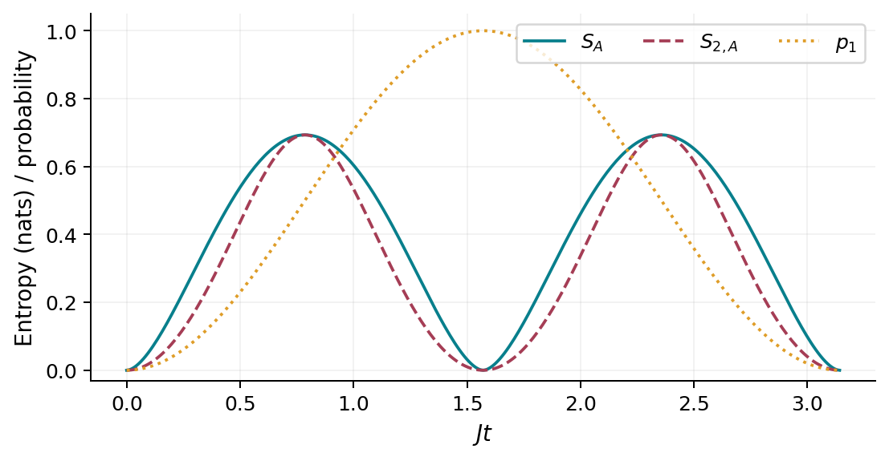
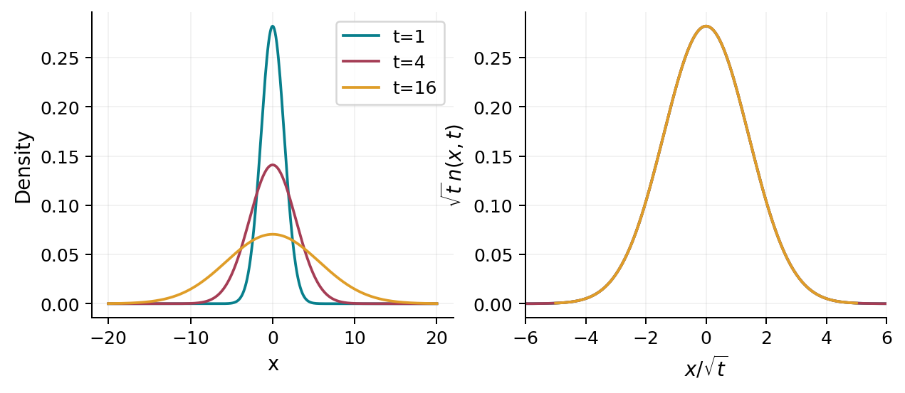
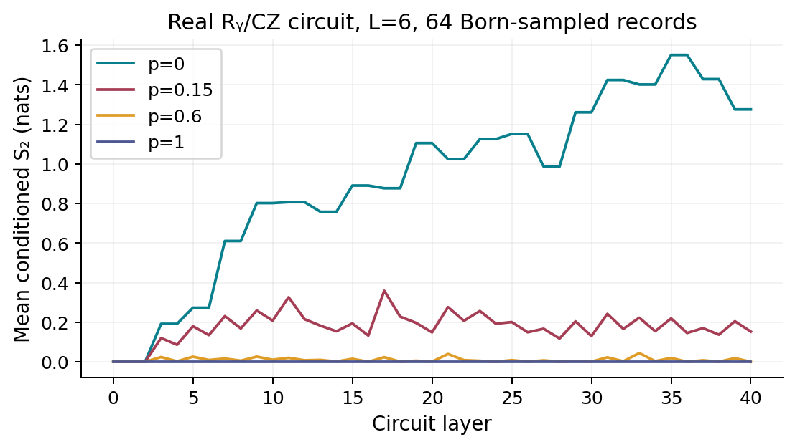
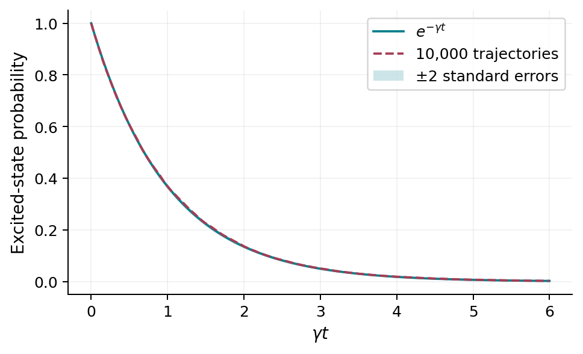

# Computational laboratory {#sec-laboratory}

## Models you can inspect and change

The browser experiments below run entirely on your device. They illustrate
specified finite models or exact continuum formulas. They neither access a
quantum processor nor establish thermodynamic phases. Their source is in
[demos/labs.js](demos/labs.js). The Julia programs provide a second, inspectable
computational path for the book's scientific figures.

## Entanglement without global entropy growth {#sec-lab-entanglement}

For $H=JX_AX_B$ and $|\psi_0\rangle=|00\rangle$,
$p_1=\sin^2(Jt)$ and $S(A)=h(p_1)$. Move the time slider and compare local
entropy with global purity. This is an exact two-qubit model. Its recurrence
is essential to its interpretation.

::: {.content-visible when-format="html"}
```{=html}
<section class="book-lab" data-lab="entanglement" aria-label="Exact entanglement laboratory">
<label>Time Jt <input aria-label="Time Jt" type="range" min="0" max="3.14159265" value="0.7854" step="0.01"></label>
<canvas role="img" aria-label="Exact subsystem entropy as a function of time"></canvas>
<output aria-live="polite"></output>
</section>
```
:::

::: {.content-visible when-format="pdf"}

:::

Predict the entropy at $Jt=0,\pi/4,\pi/2,\pi$ before moving the slider.
Then change the initial state in the source to an eigenstate of $XX$ and
explain why the entropy no longer follows this curve.

## Conserved information moves slowly {#sec-lab-diffusion}

This laboratory displays the exact infinite-line Green function
$n(x,t)=(4\pi Dt)^{-1/2}\exp[-x^2/(4Dt)]$. It solves a continuum diffusion
equation for a unit-charge delta-function initial packet, not a microscopic
spin simulation. The plotting window can omit tails; the analytically conserved
charge refers to the full line.

::: {.content-visible when-format="html"}
```{=html}
<section class="book-lab" data-lab="diffusion" aria-label="Diffusion laboratory">
<label>D <input aria-label="Diffusion coefficient" type="range" min="0.2" max="3" value="1" step="0.05"></label>
<label>t <input aria-label="Diffusion time" type="range" min="0.5" max="30" value="5" step="0.5"></label>
<canvas role="img" aria-label="Gaussian diffusion density profile"></canvas>
<output aria-live="polite"></output>
</section>
```
:::

::: {.content-visible when-format="pdf"}

:::

Verify that doubling width requires quadrupling time at fixed $D$. Explain why
the nonzero tail at every $x$ is compatible with a microscopic lattice
Lieb–Robinson bound: continuum hydrodynamics is a long-distance approximation,
not an exact description of arbitrarily small outside-cone signals.

## Measurement records and conditional entanglement {#sec-lab-circuit}

Each layer applies single-qubit rotations
$R_y(\theta)=\exp(-i\theta Y/2)$ with fixed seeded random angles, then
controlled-$Z$ gates on alternating open-chain bonds. Each site is measured in
$Z$ with probability $p$. Outcomes are sampled with Born probabilities and the
state is normalized after each measurement. The plotted quantity is the mean
second Rényi entropy across the middle cut over 32 trajectories. This real-gate
ensemble is **not** a Haar-random two-qubit circuit.

The additional output computes the purity of the empirical average full-state
density matrix using pairwise trajectory overlaps. It differs from average
trajectory entropy. Finite trajectory number biases that empirical mixed-state
estimate; it is shown to clarify the distinction, not as a precision estimator
of the infinite-ensemble state.

::: {.content-visible when-format="html"}
```{=html}
<section class="book-lab" data-lab="circuit" aria-label="Conditioned circuit laboratory">
<label>Sites <select name="L" aria-label="Number of sites"><option>4</option><option selected>6</option><option>8</option></select></label>
<label>Measurement probability <input name="p" aria-label="Measurement probability" type="number" min="0" max="1" step="0.05" value="0.15"></label>
<label>Seed <input name="seed" aria-label="Random seed" type="number" value="2026" min="1" max="1000000"></label>
<button type="button">Run trajectories</button>
<canvas role="img" aria-label="Mean conditioned second Renyi entropy by layer"></canvas>
<output aria-live="polite"></output>
<p class="lab-note">40 layers, 32 Born-sampled records, fixed gates across trajectories. A finite-chain illustration; no phase-transition fit.</p>
</section>
```
:::

::: {.content-visible when-format="pdf"}

:::

For $p=0$ all trajectories use the same unitary gates and remain identical.
For $p=1$, measuring every site after each layer leaves a product state at the
sampling times. At intermediate $p$, conditioned states remain pure globally
but can be entangled across the cut, while discarding records produces a mixed
ensemble. These limiting checks are included in the JavaScript validation.
The [measurement chapter](25-measurement-transitions.qmd) develops genuine
thermodynamic transition diagnostics and their additional requirements.

## Recreate the scientific data

Run from the repository root:

```bash
make data figures check
node scripts/check_labs.cjs
```

The main Julia program creates eight CSV datasets with a fixed random seed and
checks exact identities, charge conservation, norm/energy drift, a Krylov
reference, Gaussian projector conservation, and second-order Trotter convergence.
Its [provenance record](data/provenance.txt) contains parameters and actual
execution results. Python performs plotting of saved data; Julia performs the
numerics.

| Dataset | Calculation | What it can establish |
|---|---|---|
| [Two qubits](data/two-qubit.csv) | Analytic unitary evolution | Exact local entropy and recurrence |
| [Ising quench](data/ising-quench.csv) | Dense eigensystem, open $L=8$ | Controlled finite-time expectations and entropy |
| [Trotter error](data/trotter-convergence.csv) | Dense local gates versus exact evolution | The implemented splitting's second-order convergence |
| [Free fermions](data/free-fermions.csv) | Covariance evolution, open $L=80$ | Exact Gaussian imbalance and entropy at that size |
| [Diffusion](data/diffusion.csv) | Analytic continuum Green function | The scaling prediction, not a microscopic diffusion constant |
| [Kibble–Zurek](data/kibble-zurek.csv) | Low-momentum passage probability integrated numerically | The stated slow-ramp asymptotic formula |
| [Return rate](data/loschmidt.csv) | Thermodynamic Ising momentum quadrature | Cusp structure with finite quadrature rounding |
| [Quantum jumps](data/amplitude-damping.csv) | Exact exponential waiting times | Monte Carlo agreement with undriven amplitude damping |
| [GHD wall](data/ghd-domain-wall.csv) | Free covariance matrix, $L=240$ | Interior Euler-profile agreement at the specified times |
| [Dual channel](data/dual-channel.csv) | Phased-SWAP gate and channel powers | Exact ordinary/dual unitarity and light-ray modes |
| [Gauge protection](data/thermal-gauge-protection.csv) | Five-qubit constrained model and penalties | Finite-model leakage and conditioned-fidelity comparison |
| [MPS compression](data/mps-compression.csv) | Successive SVD of a known dense state | Canonical gauges, reconstruction, and discarded-weight checks |
| [Monitored circuit](data/monitored-circuit.csv) | $L=6$, 40 layers, 64 sampled records | Finite real-gate entropy curves, including $p=0,1$ checks |

{#fig-lab-jumps}

The Julia and browser monitored circuits use different pseudorandom generators
and 64 versus 32 records, respectively. They implement the same declared gate
and measurement model, without matching trajectory by trajectory.

The additional thermalization laboratory examines ETH matrix elements, spectral
gap ratios, disorder-induced slow dynamics, PXP revivals, Floquet truncation, and
finite-chain time-crystal controls. Its comments identify the model and checks.
These are pedagogical calculations; the [research workshop](32-research-workshop.qmd)
specifies the further work needed to reproduce a paper's frontier claim.

## Turn a demonstration into a study

Change one assumption at a time. Vary $L$, propagation parameters, initial
state, or ensemble; keep an exact or independently computed reference wherever
possible. Save both successful and failed convergence checks. A useful extension
compares a conserved packet and a nonconserved operator in the same model, or
compares conditioned entropy with a density-matrix calculation after averaging
records. State which observable has converged and which asymptotic claim remains
untested.
