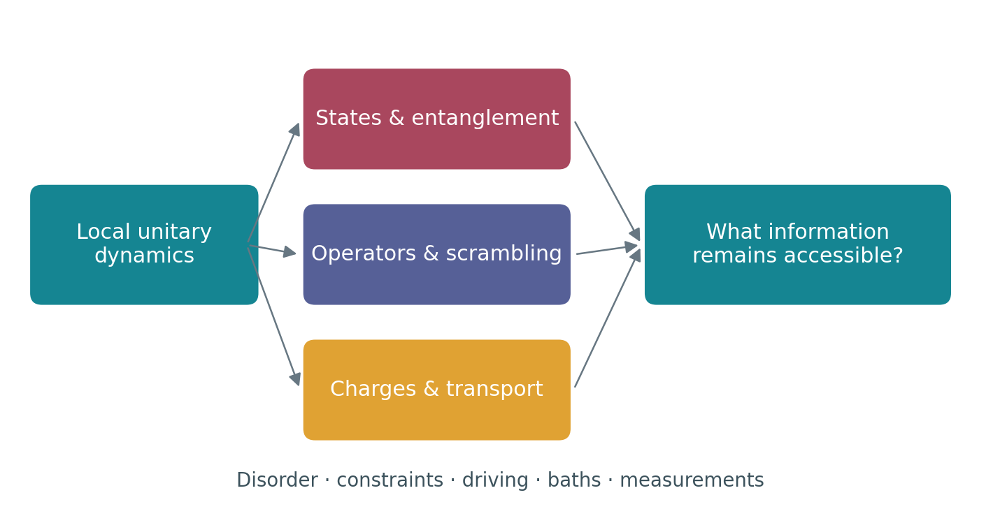

# A reader's invitation {.unnumbered}

::: {.book-intro}
**How does an isolated quantum system forget—and where does the information go?**

This question connects thermal equilibrium, quantum chaos, hydrodynamics,
entanglement, localization, measurement, and quantum error correction. The
purpose of this book is to make those connections calculable.
:::

## What this book asks of you

You should know how to diagonalize a Hermitian matrix, solve the Schrödinger
equation for a few levels, and use the canonical ensemble. You need no prior
knowledge of quantum information, Bethe ansatz, field theory, random circuits,
tensor networks, or stochastic differential equations. Those tools are developed
where they become useful. Some exercises require programming; runnable Julia
examples use only standard libraries.

The destination is independent research literacy: identify a paper's central
claim, reconstruct the argument, reproduce a clearly specified observable,
recognize uncontrolled assumptions, and design a useful extension. Reaching
that destination requires solving problems and checking calculations. Reading
alone cannot substitute for those activities.

## One problem, several descriptions

Consider a spin chain prepared in a simple product state and suddenly allowed to
interact. Its global state stays pure. A small region can nevertheless become
mixed and approximately thermal. A local perturbation can spread ballistically,
while a conserved density spreads diffusively. Disorder or constraints can
preserve memory. Repeated measurements can remove information from the chain,
or leave it encoded nonlocally. These statements refer to different observables
and different limits; their simultaneous truth is the starting point, not a
paradox to be dismissed.

The book repeatedly returns to four descriptions: a state evolving in Hilbert
space; an operator growing in space; conserved densities flowing at long
wavelength; and information shared among a system, its environment, and a
reference. Learning to translate between them is more useful than memorizing a
list of named phases.

{#fig-atlas width=95%}

## How to use the book

Start with the [learning map](learning-map.qmd). Each chapter introduces its
specialized vocabulary, develops explicit calculations, and includes exercises
with selected worked solutions. Research bridges explain why a paper was
written, what its main result establishes, how the method works, and what remains
open. Follow the [paper map](research-map.qmd) when selecting a research project.

The [computational laboratory](computational-laboratory.qmd) provides runnable
calculations and browser experiments. Numerical plots show the stated model and
parameters, rather than schematic data presented as a simulation. The source
repository contains the saved results and validation checks. The PDF download
contains the same scientific chapters with static counterparts to browser labs.

## Evidence and scope

This research edition includes selected literature verified through **22
October 2026**. It does not claim exhaustive coverage of all papers appearing
that year. Source investigation records are preserved in
[the repository](https://github.com/xing-phys/quantum-many-body-dynamics/tree/main/research).
The distinction between a theorem, a controlled approximation, numerical
evidence, experimental inference, and a conjecture is made where it matters.

Several central questions remain unsettled: the asymptotic stability and
transition of many-body localization; the full universality of anomalous spin
transport; the extent to which circuit criticality describes Hamiltonian
systems; and practical ways to access trajectory information without
prohibitive sampling. A textbook should teach the reasons for those debates,
not manufacture a consensus.

Throughout, $\hbar=k_B=1$, logarithms are natural unless stated otherwise,
and spin operators obey $S^a=\sigma^a/2$. A claim about late times must specify
whether the thermodynamic limit has already been taken. An entropy must specify
which state and which partition it describes. Those habits prevent a remarkable
number of mistakes.

## An expandable scientific record

The text was developed with AI assistance and is supplied with its derivations,
source map, computations, and build machinery for independent scrutiny. Future
revisions should add evidence and reproducible calculations, preserve useful
qualifications, and record corrections. The [research workshop](32-research-workshop.qmd)
shows how to turn such scrutiny into a research practice.
